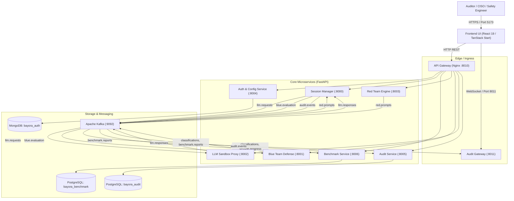
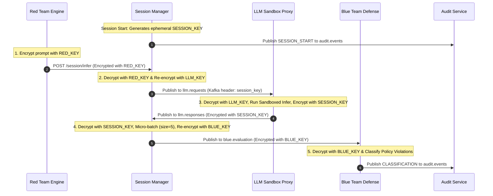

# Centinela — Automated Adversarial AI Safety Testing & Compliance Platform

<p align="center">
  
  
  
  
  
  
  
</p>

---

## 📌 Table of Contents

- [Overview](#-overview)
  - [The Challenge in Enterprise AI](#the-challenge-in-enterprise-ai)
  - [The Centinela Solution](#the-centinela-solution)
- [Key Features](#-key-features)
- [System Architecture](#-system-architecture)
  - [High-Level Architecture](#high-level-architecture)
  - [Four-Key Cryptographic Isolation Model](#four-key-cryptographic-isolation-model)
  - [Defense-in-Depth Isolation Layers](#defense-in-depth-isolation-layers)
- [Threat Model & Security Guarantees](#-threat-model--security-guarantees)
- [Technology Stack](#-technology-stack)
- [Repository Structure](#-repository-structure)
- [Getting Started & Operational Modes](#-getting-started--operational-modes)
  - [Prerequisites](#prerequisites)
  - [Mode A: Zero-Dependency Standalone Demo Runner (Recommended for Evaluation)](#mode-a-zero-dependency-standalone-demo-runner-recommended-for-evaluation)
  - [Mode B: Local Microservices Supervisor](#mode-b-local-microservices-supervisor)
  - [Mode C: Full Microservices Mesh via Docker Compose](#mode-c-full-microservices-mesh-via-docker-compose)
  - [Mode D: Cloud-Native Kubernetes / Terraform Deployment](#mode-d-cloud-native-kubernetes--terraform-deployment)
- [Microservice Port & API Catalog](#-microservice-port--api-catalog)
- [Testing & Verification](#-testing--verification)
- [Regulatory Compliance Frameworks](#-regulatory-compliance-frameworks)
- [Multi-Agent & Contributor Workstream Rules](#-multi-agent--contributor-workstream-rules)
- [Roadmap](#-roadmap)
- [Documentation Index](#-documentation-index)
- [Contributing](#-contributing)
- [License](#-license)

---

## 📖 Overview

**Centinela** (historically and internally developed under the code name **Bayora**) is an enterprise-grade automated adversarial AI safety testing, compliance certification, and multi-tenant sandboxed validation platform for Large Language Models (LLMs).

It stress-tests target models against adversarial attacks—including jailbreaks, roleplay obfuscations, multi-turn prompt injections, and semantic leaks—within a mathematically isolated execution harness. Upon drill completion, Centinela calculates defense metrics (such as Bypass Rate / Attack Success Rate and Resilience Score) and outputs tamper-evident audit records mapped directly to regulatory compliance frameworks including the **EU AI Act**, **HIPAA**, **SOX**, and **NIST AI RMF**.

### The Challenge in Enterprise AI
1. **Side-Channel Information Leakage:** Adversarial red teams with timing or cache visibility into target models can infer model weights, system prompts, or private prompt corpora.
2. **Untrusted Sandboxed Inference:** Running untrusted adversarial prompts against production-grade models risks container escapes, unauthorized kernel syscalls, and malicious network egress.
3. **Audit Immutability & Regulatory Scrutiny:** Regulators under Article 15 of the EU AI Act, HIPAA, and SOX require mathematically verifiable, tamper-evident proof that safety audits occurred as documented.

### The Centinela Solution
- **Mediated Cryptographic Message Bus:** Strict 4-key symmetric cryptographic separation (`RED_KEY`, `LLM_KEY`, `SESSION_KEY`, `BLUE_KEY`) guaranteeing zero direct network connectivity between testing teams.
- **Sandboxed Inference Proxy:** Multi-backend LLM execution (vLLM, Ollama, Hugging Face, Google Gemini) equipped with cosine semantic leak detection, prompt echo filtering, and explicit GPU VRAM / KV-cache wiping.
- **Tamper-Evident SHA-256 Merkle Ledger:** An append-only cryptographic ledger recording every cross-boundary event with public hash-chain verification (`GET /verify`).
- **Real-Time Telemetry & Modern Auditor UI:** A full-stack React 19 / TanStack Start dashboard streaming live attack feeds and metrics over WebSockets.
- **Runtime Intrusion Detection:** Falco eBPF syscall rules monitoring unauthorized probes with automated session termination upon any breach.

---

## ✨ Key Features

| Feature | Description | Status |
|---|---|---|
| **🔐 Four-Key Cryptographic Isolation** | Mediated bus broker enforces dynamic symmetric Fernet keys per session; zero direct network routes between Red and Blue teams. | ✅ Implemented |
| **⏱️ Micro-Batch Release Engine** | Aggregates LLM inference responses into micro-batches (batch size 5) before release to Blue Team, disrupting side-channel timing analysis. | ✅ Implemented |
| **⚡ Sandboxed Inference Proxy** | Supports vLLM, Ollama, Transformers, and Gemini with output echo filtering, semantic cosine leak detection ($>0.75$), and GPU VRAM purging. | ✅ Implemented |
| **🎯 Multi-Strategy Red Team Engine** | Generates adversarial attacks via Direct, DAN Jailbreaks, Roleplay obfuscation, PAIR (LLM-in-the-loop), and GCG suffix mutations. | ✅ Implemented |
| **🛡️ Fine-Tuned Blue Team Defense** | Sequence classification using `unitary/toxic-bert` fine-tuned with PEFT LoRA adapter weights to evaluate toxicity and policy violations. | ✅ Implemented |
| **📜 Tamper-Evident SHA-256 Merkle Ledger** | Append-only hash chain ledger with cryptographic proof of integrity and a public `GET /verify` endpoint for compliance auditors. | ✅ Implemented |
| **📡 Real-Time WebSocket Telemetry** | High-throughput WebSocket fanout gateway streaming live attack classifications, progress meters, and drill completion to the UI. | ✅ Implemented |
| **💻 Full-Stack Auditor Dashboard** | Full-featured UI built with React 19, TanStack Start, Tailwind CSS v4, GSAP animations, Shadcn UI, and Sonner notifications. | ✅ Implemented |
| **🚨 Runtime Intrusion Auto-Kill** | Falco integration detects unauthorized syscalls, file touches, or DNS probes and immediately terminates compromised sessions. | ✅ Implemented |
| **⚖️ Multi-Regulatory Compliance Mapping** | Direct evidence generation mapped to EU AI Act, HIPAA ePHI, SOX Section 404, and NIST AI RMF 1.0. | ✅ Implemented |

---

## 🏗️ System Architecture

### High-Level Architecture

Centinela operates across three distinct architectural tiers:



### Four-Key Cryptographic Isolation Model

Cross-team network communication is physically prevented by Kubernetes network policies, Istio mTLS, and application-level Fernet symmetric encryption:



### Defense-in-Depth Isolation Layers

| Layer | Mechanism | Purpose |
|---|---|---|
| **1. User-Space Kernel Sandbox** | **gVisor (`runsc`)** | Intercepts system calls; prevents container breakouts from untrusted model code. |
| **2. Kubernetes Namespaces** | `red-team`, `blue-team`, `llm-sandbox`, `session-manager` | Strict multi-tenant operational boundary separation. |
| **3. Network Policy (Zero-Trust)** | Kubernetes NetworkPolicy (Default Deny) | Blocks all direct East-West traffic between team namespaces. |
| **4. Service Mesh mTLS** | **Istio** PeerAuthentication & AuthorizationPolicy | Mutual TLS encryption and fine-grained SPIFFE service identity validation. |
| **5. Application Cryptography** | **Fernet (AES-128-CBC + HMAC-SHA256)** | Four-key dynamic message-payload encryption across the Kafka event bus. |
| **6. Runtime Intrusion Detection** | **Falco eBPF** | Kernel-level detection of DNS reconnaissance and unauthorized syscalls with instant auto-termination. |

---

## 🛡️ Threat Model & Security Guarantees

| Threat Vector | Attack Mechanism | Status | Mitigation in Centinela |
|---|---|---|---|
| **Network Side-Channels** | Packet sniffers, ARP spoofing, cross-namespace port scanning | ✅ Mitigated | Istio mTLS + Calico/Cilium default-deny NetworkPolicies. |
| **KV-Cache Leakage** | Probing target model KV-cache state across requests | ✅ Mitigated | `use_cache=False` enforced, explicit GPU VRAM clearing (`torch.cuda.empty_cache()` + `gc.collect()`). |
| **Timing Side-Channels** | Measuring token generation latency to infer token lengths | ✅ Mitigated | Micro-batching release engine (batch size 5) and delayed batch release after session termination. |
| **Prompt Corpus Theft** | Sniffing raw red-team attack vectors | ✅ Mitigated | Payloads encrypted via `RED_KEY`; Blue Team receives only micro-batched responses. |
| **Syscall-Level Escapes** | Exploiting host Linux kernel vulnerabilities via model code | ✅ Mitigated | gVisor `runsc` virtualized kernel + restrictive Seccomp profiles. |
| **Audit Ledger Tampering** | Retroactively altering safety test scores for certification | ✅ Mitigated | Append-only SHA-256 Merkle chain with publicly verifiable `GET /verify` cryptographic roots. |
| **Shared DRAM Timing** | Rowhammer, L3 cache eviction across physical CPU cores | ⚠️ Residual Risk | Addressed via dedicated Kubernetes node pools; future roadmap includes AMD SEV / Intel TDX. |

---

## 💻 Technology Stack

| Layer | Technology | Details |
|---|---|---|
| **Frontend UI** | **React 19**, **TanStack Start**, **Vite 7** | Full-stack SSR + SPA with TanStack Router, TanStack Query v5, Tailwind CSS v4, Lucide Icons, GSAP 3, and Sonner. |
| **API Gateway** | **Nginx 1.25** | Edge reverse proxy (Port 8010) routing REST endpoints, authentication, and WebSocket telemetry. |
| **Backend Services** | **Python 3.11+**, **FastAPI**, **Uvicorn** | Asynchronous microservices utilizing Pydantic v2, PyJWT, passlib/bcrypt, and Cryptography Fernet. |
| **Machine Learning** | **PyTorch 2.2**, **Hugging Face**, **PEFT** | LoRA-fine-tuned `unitary/toxic-bert` classifier, LiteLLM, vLLM inference engine, and Sentence-Transformers. |
| **Message Broker** | **Apache Kafka (aiokafka)** + Zookeeper | Topics: `red.prompts`, `llm.requests`, `llm.responses`, `blue.evaluation`, `audit.events`, `benchmark.reports`, `session.progress`. |
| **Databases** | **PostgreSQL 16** & **MongoDB** | `bayora_audit` (Merkle chain), `bayora_benchmark` (drills & leaderboards), `bayora_auth` (encrypted credentials). |
| **Cloud Infrastructure** | **Docker**, **Kubernetes**, **Terraform** | Multi-namespace Kubernetes manifests, Strimzi Kafka operator, Istio service mesh, AWS EKS Terraform modules. |
| **Runtime Security** | **gVisor (`runsc`)**, **Falco** | Virtualized user-space kernel runtime and real-time eBPF intrusion detection. |

---

## 📂 Repository Structure

```text
Centinela/
├── bayora/                                  # Core AI Safety Platform (Python microservices & ML)
│   ├── datasets/                            # Safety prompt datasets and adapters
│   │   ├── loaders/common.py                # DatasetLoader (AdvBench, JailbreakBench, Combined)
│   │   └── manifest.json                    # Metadata catalog of datasets & benchmarks
│   ├── infra/                               # Cloud-native infrastructure specifications
│   │   ├── gvisor/runtimeclass.yaml         # Kubernetes RuntimeClass for runsc sandboxing
│   │   ├── k8s/                             # Kubernetes manifests (namespaces, Istio, netpols)
│   │   │   ├── istio/                       # mTLS peer authentication & authorization policies
│   │   │   ├── namespaces/                  # apps.yaml, kafka.yaml, quotas, secrets-rbac
│   │   │   ├── network-policies/            # Zero-trust network policies (default-deny)
│   │   │   └── pod-security/                # Seccomp syscall filtering profiles
│   │   ├── scripts/                         # Key generation and isolation verification scripts
│   │   └── terraform/                       # AWS EKS infrastructure-as-code modules
│   ├── ml/                                  # Machine learning models & attack engines
│   │   ├── attack_generators/engine.py      # AdversarialPromptEngine (Direct, DAN, PAIR, GCG)
│   │   ├── classifiers/defense.py           # DefenseClassifier (LoRA Toxic-BERT evaluator)
│   │   ├── classifiers/train_colab.py       # Training pipeline for blue agent LoRA weights
│   │   └── models/blue_agent_lora/          # Fine-tuned adapter weights & tokenizer
│   ├── monitoring/                          # Observability & intrusion detection
│   │   ├── dashboards/                      # Grafana dashboard & Prometheus alerting config
│   │   └── falco_rules/bayora_rules.yaml    # Falco rules for cross-namespace probe detection
│   └── services/                            # FastAPI backend microservices
│       ├── audit_gateway/main.py            # WebSocket telemetry gateway (Port 8011)
│       ├── audit_service/main.py            # Append-only SHA-256 Merkle audit ledger (Port 8005)
│       ├── auth_service/main.py             # User authentication & encrypted API keys (Port 8004)
│       ├── benchmark_service/               # Drill orchestration and leaderboard (Port 8006)
│       ├── blue_team/main.py                # Blue team toxicity evaluation service (Port 8001)
│       ├── llm_proxy/                       # Inference sandbox & memory management (Port 8002)
│       ├── red_team/main.py                 # Red team adversarial attack engine (Port 8003)
│       └── session_manager/                 # Cryptographic message bus broker (Port 8000)
├── docs/codebase-discovery/                 # Comprehensive reverse-engineering documentation
│   ├── API_REFERENCE.md                     # REST endpoints, WebSocket events, and Kafka topics
│   ├── ARCHITECTURE.md                      # Architecture deep dive & Mermaid execution flows
│   ├── CODEBASE_REPORT.md                   # Comprehensive technical & architectural audit
│   ├── DATA_MODEL.md                        # Database schemas, Kafka messages, and ledger design
│   ├── FEATURE_INVENTORY.md                 # Complete catalog of 21 verified capabilities
│   ├── IMPLEMENTATION_GAPS.md               # Evidence-backed defect & technical debt audit
│   └── README.md                            # Documentation index & guide
├── frontend/                                # Full-stack Web UI (React 19 / TanStack Start)
│   ├── src/
│   │   ├── components/                      # Shell, Footer, Preloader, and Shadcn UI components
│   │   ├── lib/api.ts                       # Fetch client & WebSocket telemetry manager
│   │   └── routes/                          # TanStack router page definitions
│   │       ├── __root.tsx                   # Layout root with TanStack Query provider
│   │       ├── index.tsx                    # Landing page with interactive feature overview
│   │       ├── login.tsx & register.tsx     # Authentication screens
│   │       ├── config.tsx                   # Audit parameter selection & drill launcher
│   │       ├── audit.tsx                    # Real-time streaming audit telemetry dashboard
│   │       ├── results.tsx                  # Resilience scores & compliance certification
│   │       └── profile.tsx                  # User profile and audit history screen
│   └── package.json                         # Node dependencies & Vite 7 scripts
├── infra/nginx/centinela-gateway.conf       # Reverse proxy configuration for Port 8010
├── tests/integration/                       # Pytest integration test suite
│   ├── test_llm_proxy.py                    # Inference sandboxing & memory purge tests
│   ├── test_monitoring.py                   # Falco intrusion violation tests
│   ├── test_pipelines.py                    # Red/Blue attack and defense pipeline tests
│   └── test_session_manager.py              # Cryptographic key lifecycle & micro-batch tests
├── demo_server.py                           # Single-process standalone demo server (:8004, :8006, :8000, :8011)
├── run_backend.py                           # Multiprocess supervisor launching all 8 microservices
├── docker-compose.yml                       # Full microservices compose orchestration
├── Dockerfile                               # Universal microservice container definition
├── Makefile                                 # Build, test, and deployment automation
├── LICENSE                                  # Apache 2.0 Open Source License
└── WORKSTREAMS.md                           # Multi-agent workstream isolation rules
```

---

## 🚀 Getting Started & Operational Modes

Centinela provides multiple execution modes ranging from an instant zero-dependency local demo to a full cloud-native Kubernetes deployment:

### Prerequisites

- **Python:** 3.11 or later
- **Node.js:** 20.x or later (or Bun 1.1+)
- **Git:** 2.40+
- **Docker & Docker Compose:** *(Optional, required for Mode C & D)*

---

### Mode A: Zero-Dependency Standalone Demo Runner (Recommended for Evaluation)

The fastest way to experience Centinela. Runs Auth (`:8004`), Benchmark (`:8006`), Session Manager (`:8000`), and WebSocket Gateway (`:8011`) in a single Python process with in-memory persistence and synthetic telemetry streaming—**no Docker, Kafka, or PostgreSQL required**:

1. **Clone the repository:**
   ```bash
   git clone https://github.com/Shreyy8/Centinela.git
   cd Centinela
   ```

2. **Install core backend dependencies:**
   ```bash
   python -m venv .venv
   # Windows:
   .venv\Scripts\activate
   # Linux/macOS:
   source .venv/bin/activate

   pip install -r requirements.txt
   ```

3. **Start the demo server:**
   ```bash
   python demo_server.py
   ```
   *(Binds Auth on 8004, Session Manager on 8000, Benchmark on 8006, and WebSocket on 8011).*

4. **Start the Frontend Dashboard:**
   In a separate terminal window:
   ```bash
   cd frontend
   npm install
   npm run dev
   ```

5. **Access the application:**
   - Open your browser at **`http://localhost:5173`**.
   - Navigate to **Configuration** (`/config`), choose your attack vectors, and click **Launch Audit Drill**.
   - Watch the live telemetry feed stream in real-time (`/audit`) and view the generated **Compliance Certificate** (`/results`).

---

### Mode B: Local Microservices Supervisor

Launches all 8 production FastAPI microservices concurrently via local Python subprocesses with auto-generated Fernet keys and `MOCK_LLM=1`:

```bash
python run_backend.py
```

This supervisor automatically generates cryptographic keys, sets the required environment variables, and orchestrates health checks across all 8 services.

---

### Mode C: Full Microservices Mesh via Docker Compose

Launches the complete production container mesh—including Apache Kafka, Zookeeper, PostgreSQL (`bayora_audit`, `bayora_benchmark`), MongoDB (`bayora_auth`), Nginx reverse proxy, and all 8 microservices:

```bash
# 1. Generate cryptographic keys
python bayora/infra/scripts/generate-keys.py

# 2. Build and launch all containers
docker compose up --build
```

**Bound Edge Endpoints:**
- Nginx Gateway: `http://localhost:8010`
- WebSocket Telemetry: `ws://localhost:8011/ws/stream`
- PostgreSQL: `localhost:5432`
- MongoDB: `localhost:27017`

---

### Mode D: Cloud-Native Kubernetes / Terraform Deployment

For staging and production environments requiring gVisor kernel sandboxing and Istio mTLS:

```bash
# Deploy AWS EKS infrastructure via Terraform
make deploy
```

This executes:
1. `bayora/infra/terraform` EKS cluster provisioning.
2. Strimzi Kafka Operator deployment in the `kafka` namespace.
3. Multi-namespace isolation (`red-team`, `blue-team`, `llm-sandbox`, `session-manager`).
4. Zero-trust Kubernetes NetworkPolicies and gVisor `runsc` RuntimeClass.
5. Istio mutual TLS peer authentication and authorization policies.

---

## 🔌 Microservice Port & API Catalog

When running via Docker Compose or Nginx, all traffic routes through the unified API Gateway at port **`8010`**. When running locally, microservices can also be accessed directly:

| Service | Direct Port | Gateway Route (`:8010`) | Primary Responsibility |
|---|---|---|---|
| **API Gateway (Nginx)** | `8010` | `/` | Edge reverse proxy, SSL termination, path routing |
| **Auth & Config Service** | `8004` | `/api/auth/`, `/api/config/` | User signup/login, JWT tokens, encrypted LLM API keys |
| **Session Manager** | `8000` | `/api/session/` | Dynamic key generation, mediated bus proxying, micro-batching |
| **LLM Sandbox Proxy** | `8002` | `/api/llm/` | Sandboxed inference, echo/semantic leak filtering, VRAM purging |
| **Red Team Engine** | `8003` | `/api/attack/` | Multi-strategy adversarial prompt generation |
| **Blue Team Defense** | `8001` | `/api/evaluate/` | Toxic-BERT LoRA policy evaluation and classification |
| **Benchmark Service** | `8006` | `/api/drills/`, `/api/leaderboard` | Drill runner orchestration, progress tracking, leaderboards |
| **Audit Service** | `8005` | `/api/verify` | Append-only SHA-256 Merkle audit ledger & verification |
| **Audit Gateway** | `8011` | `/ws/` | WebSocket real-time telemetry streaming |

### Key API Examples

#### 1. User Authentication
```bash
curl -X POST http://localhost:8004/auth/login \
  -H "Content-Type: application/json" \
  -d '{"email": "auditor@enterprise.com", "password": "SecurePassword123!"}'
```

#### 2. Start an Isolated Testing Session
```bash
curl -X POST http://localhost:8000/session/start \
  -H "Authorization: Bearer <TOKEN>"
# Returns: {"session_id": "...", "status": "ACTIVE"}
```

#### 3. Cryptographic Merkle Chain Verification
```bash
curl -X GET http://localhost:8005/verify
# Returns: {"verified": true, "head_hash": "...", "entry_count": 42}
```

---

## 🧪 Testing & Verification

Centinela includes a comprehensive automated integration test suite located in `tests/integration/`:

```bash
# 1. Session Manager Lifecycle & Micro-Batching Tests
python -m pytest tests/integration/test_session_manager.py -v

# 2. Monitoring & Falco Intrusion Breach Auto-Kill Tests
python -m pytest tests/integration/test_monitoring.py -v

# 3. Red Team Attack & Blue Team Defense Pipeline Tests
python -m pytest tests/integration/test_pipelines.py -v

# 4. LLM Sandbox Inference & Semantic Leak Filter Tests
python -m pytest tests/integration/test_llm_proxy.py -v
```

### Frontend Validation & Linting
```bash
cd frontend
# Check TypeScript types & ESLint rules
npm run lint

# Validate full production build
npm run build
```

---

## ⚖️ Regulatory Compliance Frameworks

Centinela directly translates raw adversarial bypass metrics into concrete compliance audit trails:

| Regulation / Standard | Specific Article / Section | Centinela Enforcement Mechanism |
|---|---|---|
| **EU AI Act** | **Article 15 (Accuracy, Robustness & Cybersecurity)** | Tests resilience against adversarial prompt injections and jailbreaks; logs verifiable bypass rates. |
| **EU AI Act** | **Article 9 & 14 (Risk Management & Human Oversight)** | Real-time WebSocket telemetry enables immediate kill-switch intervention by human safety officers. |
| **HIPAA Security Rule** | **45 CFR § 164.312(b) (Audit Controls)** | Immutable SHA-256 Merkle chain records all model queries and responses without plaintext leakage. |
| **SOX / SOC 2 Type II** | **Trust Services Criteria (Security & Confidentiality)** | Cryptographic 4-key isolation prevents unauthorized prompt exfiltration between tenants. |
| **NIST AI RMF 1.0** | **Govern 1.2, Measure 2.5, Manage 2.4** | Quantitative scoring (Resilience Score, Attack Success Rate) across standardized adversarial benchmarks. |

---

## 👥 Multi-Agent & Contributor Workstream Rules

To allow multiple autonomous AI agents and engineers to collaborate concurrently without merge conflicts or dependency deadlocks, Centinela strictly enforces two isolated workstream tracks (see [WORKSTREAMS.md](WORKSTREAMS.md)):

```text
┌────────────────────────────────────────────────────────┐
│               Track 1: Platform & Infra                │
│  Owned: session_manager/**, audit_service/**, infra/** │
│         docker-compose.yml, Dockerfile, Makefile       │
│  Scope: Cryptography, Kafka, Merkle Ledger, K8s, Falco │
└────────────────────────────────────────────────────────┘
                           ▲
             [Zero Cross-Track File Overlaps]
                           ▼
┌────────────────────────────────────────────────────────┐
│               Track 2: Frontend & ML                   │
│  Owned: frontend/**, bayora/ml/**, bayora/datasets/**  │
│         auth_service/**, llm_proxy/**, test_llm_proxy  │
│  Scope: React 19 UI, Classifiers, AdvBench, vLLM/Gemini│
└────────────────────────────────────────────────────────┘
```

> **Rule for Contributors & Agents:** Never modify files outside your assigned track. Track 2 developers must use `demo_server.py` for rapid zero-dependency frontend and ML verification.

---

## 🗺️ Roadmap

- [x] Ephemeral 4-key Fernet symmetric bus encryption.
- [x] Timing mitigation micro-batch release engine.
- [x] Real-time WebSocket attack streamer & TanStack Start UI.
- [x] Tamper-evident SHA-256 Merkle audit ledger with public `/verify`.
- [x] Falco eBPF syscall intrusion monitoring and auto-termination.
- [ ] **Hardware-Enforced Memory Encryption:** Integration with Intel TDX / AMD SEV for confidential computing DRAM protection.
- [ ] **Extended Safety Datasets:** Full automated ingestion of 520+ AdvBench and 100+ JailbreakBench prompts.
- [ ] **Native PDF Compliance Export:** Client-side vector PDF generation for regulatory audit binders.
- [ ] **Cryptographic Image Signing:** Cosign and Sigstore integration for zero-trust container admission control.

---

## 📚 Documentation Index

For exhaustive architecture details and deep-dive technical reports, consult the discovery documentation in [`docs/codebase-discovery/`](docs/codebase-discovery/):

- 📄 [**`CODEBASE_REPORT.md`**](docs/codebase-discovery/CODEBASE_REPORT.md) — Comprehensive technical lead report, security analysis, and runtime topologies.
- 📐 [**`ARCHITECTURE.md`**](docs/codebase-discovery/ARCHITECTURE.md) — Component boundaries, cryptographic key lifecycle, and 6 Mermaid sequence/flow diagrams.
- 📋 [**`FEATURE_INVENTORY.md`**](docs/codebase-discovery/FEATURE_INVENTORY.md) — Line-by-line verification of all 21 system features.
- 🔌 [**`API_REFERENCE.md`**](docs/codebase-discovery/API_REFERENCE.md) — Complete REST endpoint, WebSocket event, and Kafka topic specification.
- 🗄️ [**`DATA_MODEL.md`**](docs/codebase-discovery/DATA_MODEL.md) — PostgreSQL, MongoDB, Kafka event schemas, and Merkle ledger mechanics.
- 🛠️ [**`IMPLEMENTATION_GAPS.md`**](docs/codebase-discovery/IMPLEMENTATION_GAPS.md) — Defect analysis, TypeScript warnings, and prioritized technical debt catalog.
- 📊 [**`summary.json`**](docs/codebase-discovery/summary.json) — Machine-readable architectural index.

---

## 🤝 Contributing

We welcome contributions from AI safety researchers, security engineers, and full-stack developers!

1. Fork the repository on GitHub.
2. Create a feature branch: `git checkout -b feature/amazing-feature`.
3. Adhere to the [Multi-Agent Workstream Rules](WORKSTREAMS.md) to ensure your changes stay within the appropriate track.
4. Run the integration test suite: `pytest tests/integration/`.
5. Ensure your frontend code passes linting: `cd frontend && npm run lint`.
6. Submit a pull request with a descriptive summary of your changes.

---

## 📄 License

Centinela is licensed under the **Apache License, Version 2.0**. See the [LICENSE](LICENSE) file for full copyright notices and terms of use:

```text
Copyright 2026 Centinela Contributors

Licensed under the Apache License, Version 2.0 (the "License");
you may not use this file except in compliance with the License.
You may obtain a copy of the License at

    http://www.apache.org/licenses/LICENSE-2.0

Unless required by applicable law or agreed to in writing, software
distributed under the License is distributed on an "AS IS" BASIS,
WITHOUT WARRANTIES OR CONDITIONS OF ANY KIND, either express or implied.
See the License for the specific language governing permissions and
limitations under the License.
```
