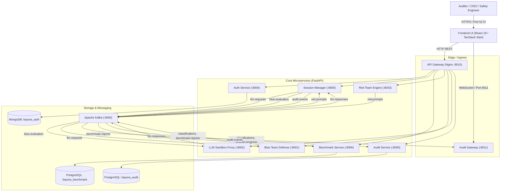
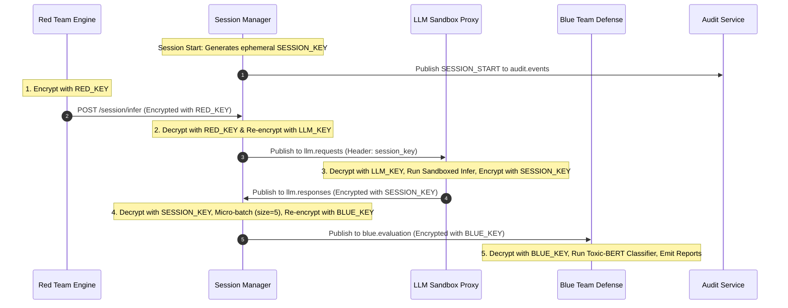
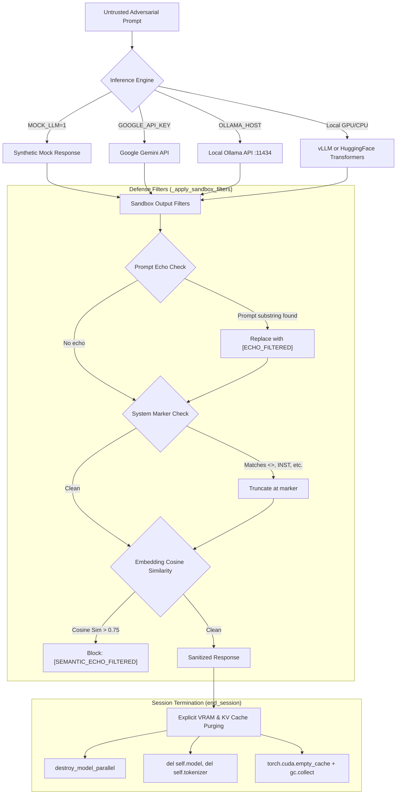

# Centinela (Bayora) — Architecture & Execution Flows

> **Document Type:** System Architecture Specification & Execution Flow Discovery  
> **Repository:** [Centinela (formerly Bayora)](https://github.com/Shreyy8/Centinela.git)  
> **Status:** Verified against source code  

---

## 1. System Architecture Overview

Centinela is built upon a **mediated microservices architecture** operating across three distinct layers:
1. **Presentation & Gateway Layer:** A React 19 / TanStack Start frontend communicating with backend services via Nginx reverse proxy (Port 8010) or direct service ports in local development.
2. **Cryptographic Core & Orchestration Layer:** FastAPI services coordinating attack generation, evaluation, and benchmark reporting through an isolated Apache Kafka message broker. All inter-service message flows are mediated by `session-manager` using dynamic symmetric keys.
3. **Data & Telemetry Layer:** PostgreSQL databases (`bayora_audit` and `bayora_benchmark`), MongoDB (`bayora_auth`), an append-only SHA-256 hash ledger, and an asynchronous WebSocket fanout gateway.



---

## 2. Cryptographic Message Bus & Isolation Model

Centinela implements **zero direct network connectivity** between the Red Team, Blue Team, and LLM Proxy. Direct communication is prevented by Kubernetes network policies, Istio mTLS authorization policies, and application-level symmetric cryptography using Fernet (AES-128-CBC + HMAC-SHA256).

### The Four-Key Isolation Architecture



1. **`RED_KEY`**: Static symmetric key possessed only by Red Team and Session Manager. Red Team encrypts generated adversarial prompts before publishing to `red.prompts`.
2. **`LLM_KEY`**: Static symmetric key possessed only by Session Manager and LLM Proxy. Session Manager decrypts red prompts with `RED_KEY` and re-encrypts with `LLM_KEY` before forwarding to `llm.requests`.
3. **`SESSION_KEY`**: Ephemeral, dynamically generated 32-byte key created per drill by Session Manager. LLM Proxy uses this key to encrypt responses sent to `llm.responses`.
4. **`BLUE_KEY`**: Static symmetric key possessed only by Session Manager and Blue Team. Session Manager decrypts responses with `SESSION_KEY`, aggregates them into micro-batches of 5 (to destroy prompt-response timing correlation), re-encrypts the batch with `BLUE_KEY`, and produces to `blue.evaluation`.

---

## 3. End-to-End Execution Flow: Running an Adversarial Audit

Tracing a user starting an audit on `/config` through completion:

```mermaid
sequenceDiagram
    actor User
    participant Frontend as Frontend (/config & /audit)
    participant BenchSvc as Benchmark Service (:8006)
    participant SessionMgr as Session Manager (:8000)
    participant RedTeam as Red Team Engine (:8003)
    participant LLMProxy as LLM Proxy (:8002)
    participant BlueTeam as Blue Team Defense (:8001)
    participant WSGateway as Audit Gateway (:8011)

    User->>Frontend: Selects model, domain, budget; Clicks "EXECUTE ADVERSARIAL AUDIT"
    Frontend->>BenchSvc: POST /drills/run {drill_name, domain, count}
    
    BenchSvc->>SessionMgr: POST /session/start
    SessionMgr-->>BenchSvc: Returns {session_id, session_key}
    BenchSvc->>BenchSvc: Insert benchmark_runs (status='pending')
    
    BenchSvc->>RedTeam: POST /attack/stream {session_id, count, dataset_name}
    BenchSvc-->>Frontend: Returns {status: 'drill_started', session_id}
    
    Frontend->>Frontend: Navigate to /audit?session_id=...
    Frontend->>WSGateway: Connect WebSocket ws://localhost:8011/ws/{session_id}
    WSGateway-->>Frontend: {"type": "connected", "session_id": ...}

    loop For each attack batch (10 prompts)
        RedTeam->>SessionMgr: Stream encrypted attacks via Kafka red.prompts
        SessionMgr->>LLMProxy: Re-encrypt and send via Kafka llm.requests
        LLMProxy->>LLMProxy: Sandboxed inference (echo & semantic filter)
        LLMProxy->>SessionMgr: Encrypted response via Kafka llm.responses
        
        alt Micro-batch threshold reached (count >= 5)
            SessionMgr->>BlueTeam: Re-encrypt bundle via Kafka blue.evaluation
            BlueTeam->>BlueTeam: Evaluate toxicity with LoRA Toxic-BERT
            BlueTeam->>WSGateway: Emit classification to Kafka classifications
            WSGateway-->>Frontend: WebSocket {"type": "classification", data: {...}}
            WSGateway-->>Frontend: WebSocket {"type": "progress", data: {...}}
        end
    end

    BlueTeam->>BenchSvc: Publish final report to Kafka benchmark.reports
    BenchSvc->>BenchSvc: Update benchmark_runs (status='completed', bypass_rate)
    BenchSvc->>SessionMgr: POST /session/end (Destroy session keys & purge memory)
    WSGateway-->>Frontend: WebSocket {"type": "session_ended", data: {...}}
    Frontend->>User: Display completed status & enable "VIEW FINAL RESULTS"
```

---

## 4. Sandboxed Inference Engine Architecture

Located in [bayora/services/llm_proxy/inference.py](file:///bayora/services/llm_proxy/inference.py), the `SandboxedInference` engine enforces security barriers on untrusted LLM outputs:



---

## 5. Standalone Runners Architecture

To enable rapid local development and demoing without complex distributed infrastructure, Centinela includes two purpose-built runners:

### 1. `demo_server.py` (Single-Process Zero-Dependency Runner)
- Spawns background threads within a single Python runtime:
  - Port 8004: Mock Auth & Settings service
  - Port 8006: Mock Benchmark service with in-memory `RUNS_DB`
  - Port 8000: Mock Session Manager with static cryptographic verification proof
  - Port 8011: Mock WebSocket Gateway streaming 25 simulated attacks (Prompt Injection, DAN, Roleplay, GCG) with realistic pacing and confidence scores.
- Allows recording demos and testing UI components with zero external dependencies.

### 2. `run_backend.py` (Direct Microservices Process Supervisor)
- Launches all 8 production FastAPI microservice modules in parallel local processes via `subprocess.Popen`:
  - `bayora.services.auth_service.main:app` (:8004)
  - `bayora.services.session_manager.main:app` (:8000)
  - `bayora.services.audit_service.main:app` (:8005)
  - `bayora.services.benchmark_service.main:app` (:8006)
  - `bayora.services.red_team.main:app` (:8003)
  - `bayora.services.blue_team.main:app` (:8001)
  - `bayora.services.llm_proxy.main:app` (:8002)
  - `bayora.services.audit_gateway.main:app` (:8011)
- Automatically initializes environment variables, generates cryptographic Fernet keys in-memory, sets `MOCK_LLM=1`, and provides graceful SIGINT shutdown handling.

---

## 6. Cloud Deployment Topology (Kubernetes & Istio)

In production Kubernetes deployments:
- **Namespaces:** `session-manager`, `audit-log`, `blue-team`, `red-team`, `llm-sandbox`, `benchmark`, `kafka`.
- **Runtime Sandboxing:** `session-manager`, `blue-team`, `red-team`, and `llm-proxy` declare `runtimeClassName: gvisor-sandboxed`, executing containers under the gVisor `runsc` application kernel to intercept unauthorized syscalls.
- **Service Mesh & Network Policies:** Istio enforces `STRICT` mTLS peer authentication. Default-deny Kubernetes network policies prevent any direct IP routing between `red-team` and `blue-team` or `llm-sandbox`.
- **Intrusion Detection:** Falco monitors container runtime behavior, detecting cross-namespace DNS probes or blocked syscall invocations (`ptrace`, `perf_event_open`). Violations trigger automated session termination via `bayora/services/session_manager/violations.py`.
