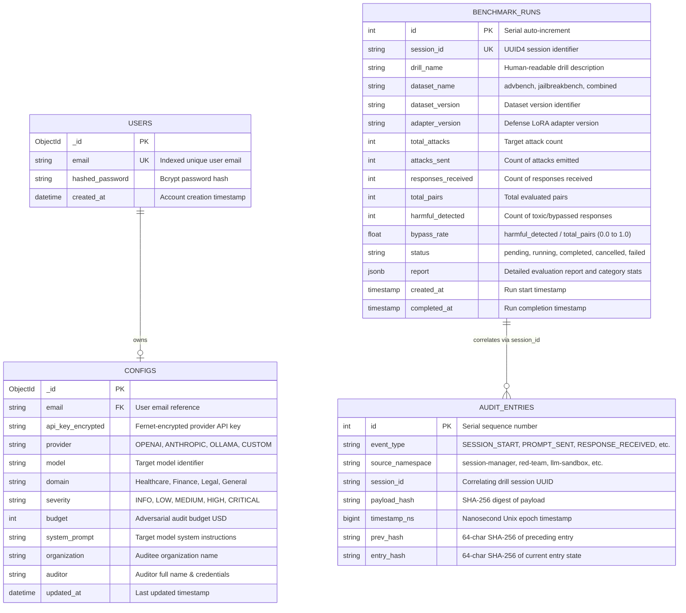
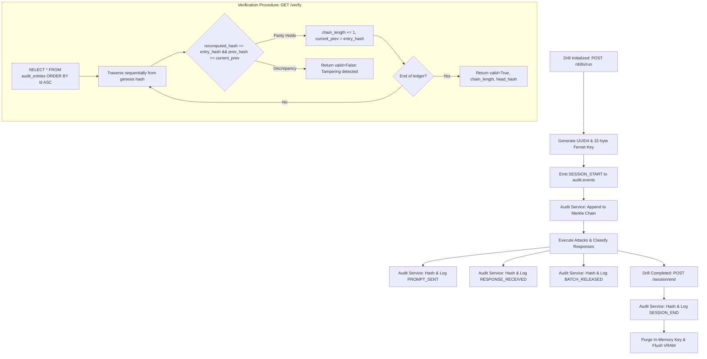

# Centinela (Bayora) — Data Model & Storage Lifecycle

> **Document Type:** Database Schema, Storage Systems & Cryptographic Data Lifecycle  
> **Repository:** [Centinela (formerly Bayora)](https://github.com/Shreyy8/Centinela.git)  
> **Status:** Code-verified against database initialization scripts  

---

## 1. Storage Systems Overview

Centinela employs a polyglot persistence architecture configured for regulatory compliance and audit isolation:

| Datastore | Technology | Database / Instance | Key Entities | Resilience Pattern |
|---|---|---|---|---|
| **Audit Ledger** | PostgreSQL 16 | `bayora_audit` | `audit_entries` (SHA-256 Merkle chain) | In-memory chain fallback (`self.chain`) |
| **Benchmark Store**| PostgreSQL 16 | `bayora_benchmark` | `benchmark_runs` (Drill results & leaderboard) | In-memory runs fallback (`self._memory_runs`)|
| **Auth & Config** | MongoDB | `bayora_auth` | `users`, `configs` (Encrypted API keys) | Timeout-protected fallback (`demo_mode`) |
| **Volatile State** | In-Memory / Python | All Services | `session_keys`, `session_stores`, `active_sessions` | Explicit destruction via garbage collection |

---

## 2. Entity-Relationship & Schema Diagram



---

## 3. Relational Schemas (PostgreSQL)

### 3.1 `bayora_audit.audit_entries`
Defined in [bayora/services/audit_service/main.py:44-55](file:///bayora/services/audit_service/main.py#L44-L55).

```sql
CREATE TABLE IF NOT EXISTS audit_entries (
    id SERIAL PRIMARY KEY,
    event_type VARCHAR(255) NOT NULL,
    source_namespace VARCHAR(255) NOT NULL,
    session_id VARCHAR(255) NOT NULL,
    payload_hash VARCHAR(64) NOT NULL,
    timestamp_ns BIGINT NOT NULL,
    prev_hash VARCHAR(64) NOT NULL,
    entry_hash VARCHAR(64) NOT NULL
);
```

#### Fields & Forensic Constraints:
- `event_type`: Categorizes boundary activity (`SESSION_START`, `PROMPT_SENT`, `RESPONSE_RECEIVED`, `BATCH_RELEASED`, `SESSION_END`, `ISOLATION_BREACH`).
- `source_namespace`: Kubernetes namespace originating the action.
- `session_id`: Unique identifier binding entries to a specific drill.
- `payload_hash`: SHA-256 hash of the plaintext message payload (ensures plaintext content is never persisted in the audit database).
- `timestamp_ns`: Monotonic timestamp recorded via `time.time_ns()`.
- `prev_hash`: Pointer to the `entry_hash` of the preceding record (initialized to `SHA-256("genesis")`).
- `entry_hash`: Hash digest computed over the JSON representation of the entry:
  $$\text{entry\_hash} = \text{SHA256}(\text{JSON}(\text{event\_type}, \text{source\_namespace}, \text{session\_id}, \text{payload\_hash}, \text{timestamp\_ns}, \text{prev\_hash}))$$

### 3.2 `bayora_benchmark.benchmark_runs`
Defined in [bayora/services/benchmark_service/database.py:31-56](file:///bayora/services/benchmark_service/database.py#L31-L56).

```sql
CREATE TABLE IF NOT EXISTS benchmark_runs (
    id SERIAL PRIMARY KEY,
    session_id VARCHAR(255) NOT NULL UNIQUE,
    drill_name VARCHAR(255),
    dataset_name VARCHAR(255),
    dataset_version VARCHAR(50),
    adapter_version VARCHAR(50),
    total_attacks INTEGER DEFAULT 0,
    attacks_sent INTEGER DEFAULT 0,
    responses_received INTEGER DEFAULT 0,
    total_pairs INTEGER,
    harmful_detected INTEGER,
    bypass_rate FLOAT,
    status VARCHAR(50) DEFAULT 'pending',
    report JSONB,
    created_at TIMESTAMP DEFAULT CURRENT_TIMESTAMP,
    completed_at TIMESTAMP
);

CREATE INDEX IF NOT EXISTS idx_benchmark_runs_session_id ON benchmark_runs(session_id);
CREATE INDEX IF NOT EXISTS idx_benchmark_runs_status ON benchmark_runs(status);
```

---

## 4. Document Store Schema (MongoDB `bayora_auth`)

Managed by Motor (AsyncIO MongoDB driver) in [bayora/services/auth_service/main.py](file:///bayora/services/auth_service/main.py).

### 4.1 Collection: `users`
```json
{
  "_id": { "$oid": "664fa1e2b4c19a0012345678" },
  "email": "sarah.chen@northwind.health",
  "hashed_password": "$2b$12$e8YkZ8Q8k3P.q8eF...bcrypt...",
  "created_at": { "$date": "2026-10-15T09:00:00Z" }
}
```

### 4.2 Collection: `configs`
```json
{
  "_id": { "$oid": "664fa1e2b4c19a0012345679" },
  "email": "sarah.chen@northwind.health",
  "api_key_encrypted": "gAAAAABl6Z8Q8k3P...fernet-ciphertext...",
  "provider": "OPENAI",
  "model": "gpt-4-turbo-preview",
  "domain": "Healthcare",
  "severity": "MEDIUM",
  "budget": 250,
  "system_prompt": "You are a helpful assistant specialized in security research.",
  "organization": "Northwind Health",
  "auditor": "Sarah Chen, CISO",
  "updated_at": { "$date": "2026-10-18T10:15:00Z" }
}
```

---

## 5. Data Lifecycle & Cryptographic Verification


